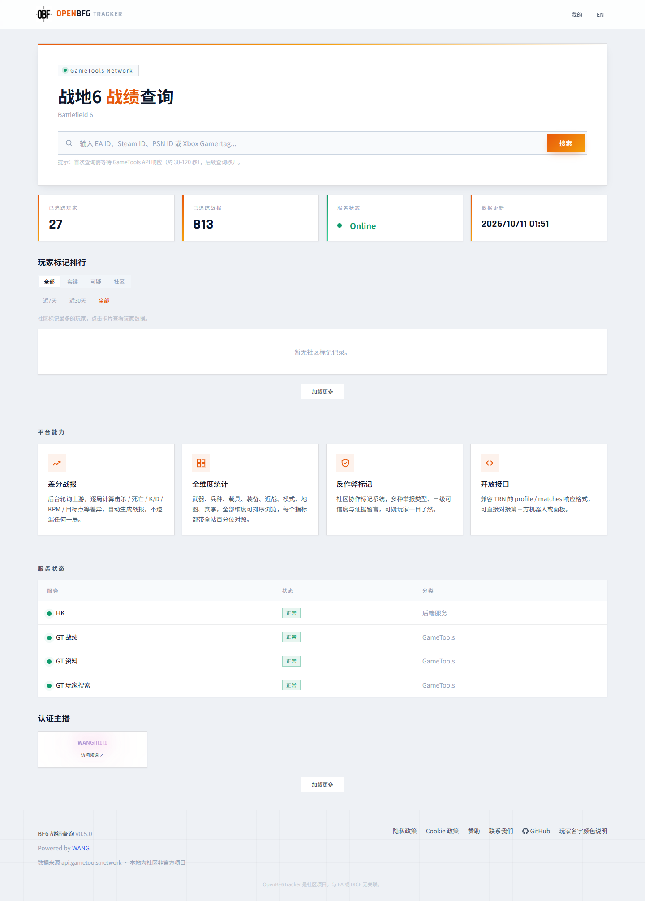
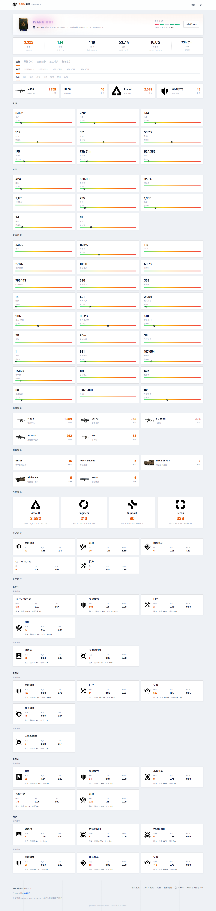
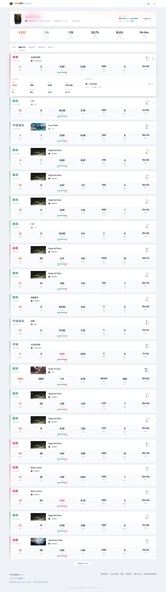

# OpenBF6Tracker

战地风云 6 全平台玩家战绩查询与社区反作弊标记工具。

基于 Next.js 15 构建，对接 [GameTools Network](https://api.gametools.network) API，支持 Origin / Steam / PlayStation / Xbox 四大平台的全方位数据查询。

## 界面预览

### 首页



### 玩家档案



### 战报



## 功能特性

### 战绩查询
- 按玩家名称搜索，自动并行探测四大平台（EA / Steam / PSN / Xbox）
- **本地兜底**：上游按名搜索失败时，自动从已追踪档案中匹配，保证库内玩家一定能搜到
- **生涯概览条**：击杀/死亡、K/D/真人 K/D、KPM/每场击杀、胜率/胜负、命中率/命中数与射击数、时长/场次
- **最近 5 场状态**：逐场展示胜负色条与场均 K/D（从真实战报逐场计算，平局单独配色）
- **生涯 / 战斗 / 更多数据**：共 44 项指标，每项都带百分位条
- **百分位条**：每项统计对照全部追踪玩家，实时计算 P10–P90 分布，条形标出该玩家位置（前 X% / 后 X%），悬停查看完整分布样本
- **武器详情**：击杀、爆头击杀、命中率、KPM、使用时长、伤害、射击/命中数、躯干/腰射/瞄镜击杀、多杀等
- **载具详情**：击杀、摧毁、造成/承受伤害、撞击击杀、行驶距离、驾驶时长、各类助攻等
- **兵种分析**：突击兵/工程兵/支援兵/侦察兵的击杀、死亡、K/D、KPM、SPM、时长
- **装备统计**：各类装备的击杀、伤害、使用次数、助攻、索敌等
- **近战武器**：每把刀的击杀、处决、使用次数、KPM、DPM
- **模式分析**：各游戏模式的胜场、胜率、K/D、KPM、时长
- **地图统计**：每张地图的胜场和败场
- 所有图标一律使用上游返回的图片地址，**上游没有返回图片时留空**，不显示占位块

### 赛季分类
- 支持**全面战争**和**禁区冲突**（大逃杀/试炼场）两个大类的独立展示
- 按 **Season 1 / 2 / 3 / 4 / 5** 拆分每个赛季的数据
- 每个赛季内可分别查看武器、载具、装备、兵种、模式、地图、近战等子分类
- 生涯数据为全部赛季自动聚合，不硬编码赛季号

### 战报系统
- TRN segment 维度差分：逐 counter 相减全字段，衍生指标（K/D/KPM/SPM）从 delta 重新计算
- 自动过滤聚合项和零增量项，图片从新快照提取
- **卡片式展示**：左侧胜负色条、大号中文结果（胜利 / 战败 / 平局 / 中途退出）、地图缩略图、模式图标、胜负数
- **数据条**：击杀、死亡、K/D（含击杀占比条）、KPM、得分/SPM、爆头/爆头率、时长
- **展开明细**：本局概览、模式明细、兵种、目标点与支援、武器、载具、装备、近战

### 后台自动轮询
- 服务启动即开启，无需外部 cron
- **分级策略**：赞助者每 5 分钟、近期搜索玩家每 10 分钟、24 小时内未搜索的玩家自动跳过
- 通过 `POST /bf6/multiple/` 批量查询，**hash 与写入内容取自同一份快照**（避免哈希与数据不一致导致档案永久停更）
- 批量接口使用 `seperation=true`，与单查接口字段完全一致（含 `perSeason` / `perGamemode`）
- 兼容上游三种返回形态：单玩家裸对象、多玩家 `{data:[...]}`、原始数组
- 环境变量 `BF6_POLL_INTERVAL_SECONDS` 可调轮询间隔（默认 300 秒）

### 社区反作弊
- 登录后可对可疑玩家进行**匿名举报**
- 支持 aimbot / wallhack / DMA / macro / recoil / converter / toxic 等多种举报类型
- 投稿时选择可信度等级并附证据说明
- 举报后在「我的」页面查看自己的举报记录和处理结果
- 管理员可在后台审核标记的可信度（低/中/高）

### 账号与工单
- JWT 令牌认证（jose + bcryptjs）
- 注册只需账号 + 密码
- 登录后可提交工单（问题反馈 / 申请主播认证 / 赞助）
- 「我的」页面查看工单记录和状态

### 赞助系统
- 六级赞助等级：站长 / Tier 1-4 / 协助者
- 不同等级玩家名字显示不同的渐变动画色彩和光晕效果

### 管理后台
- 赞助者管理（添加/删除）
- 留言查看
- 标记审核（可信度评定）
- 主播管理（添加/删除）
- 用户管理（改密 / 封禁 / 设为管理）
- 管理员密码修改

### 服务状态
- 首页以表格形式显示后端服务和 GameTools API 各节点的实时健康状态

## 设计系统

- **浅色主题**：直角（无圆角）、橙色强调色 `#e8590c`、细网格底纹
- **字体**：Rajdhani（数字与拉丁展示）+ Noto Sans SC（中文正文）
- **卡片结构**：`.card` / `.ocard` / `.okit` / `.omode` / `.prow` / `.m`（战报卡）
- **百分位条**：`.pct`，绿→黄→橙→红分布条 + 圆形锚点 + 悬停浮层
- 设计变量集中在 `src/app/globals.css` 的 `:root`，改一处全站生效

## 技术栈

| 层级 | 技术 |
|------|------|
| **框架** | Next.js 15 (App Router) + React 19 + TypeScript |
| **样式** | Tailwind CSS + 自定义 CSS 设计系统 |
| **数据库** | SQLite (better-sqlite3) |
| **认证** | JWT (jose) + bcryptjs |
| **字体** | Rajdhani + Noto Sans SC (Google Fonts) |
| **数据源** | [GameTools Network API](https://api.gametools.network) |
| **国际化** | react-i18next (中/英) |

## 项目结构

```
src/
├── app/
│   ├── admin/           # 管理后台页面
│   ├── api/
│   │   ├── admin/       # 管理 API（marks/messages/sponsors/streamers/users/password）
│   │   ├── auth/        # 认证 API（login/logout/me/register）
│   │   ├── contact/     # 联系我们 API
│   │   ├── matches/     # 战报 API
│   │   ├── my/activity/ # 我的活动 API
│   │   ├── players/     # 玩家排行 / 主播 API
│   │   ├── profile/     # 玩家档案 API + TRN 格式 builder
│   │   ├── search/      # 搜索 API（含本地兜底）
│   │   ├── stats/percentiles/  # 百分位分布 API
│   │   ├── status/      # 服务状态 API
│   │   ├── suspicion/   # 举报 API
│   │   └── ...
│   ├── contact/         # 联系我们页面
│   ├── my/              # 我的页面
│   ├── player/          # 玩家档案页面
│   ├── status/          # 服务状态页面
│   └── ...
├── components/
│   ├── PlayerClient.tsx  # 主玩家数据展示组件（英雄区 / 导航 / 总览 / 战报 / 明细）
│   ├── AuthContext.tsx   # 认证上下文
│   ├── SponsorContext.tsx # 赞助者系统（名字渐变样式）
│   ├── Header.tsx        # 顶部导航 + 品牌标识
│   ├── Footer.tsx        # 页脚
│   ├── SearchBar.tsx     # 搜索框（历史记录 / 候选下拉）
│   └── ...
└── lib/
    ├── db.ts             # SQLite 数据库层
    ├── gametools.ts      # GameTools API 客户端
    ├── poller.ts         # 后台轮询器
    ├── delta.ts          # 战报差分引擎
    ├── percentiles.ts    # 百分位计算
    ├── api.ts            # 前端 API 调用
    ├── auth.ts           # JWT 签名/验证
    └── types.ts          # TypeScript 类型定义
```

## 数据库

使用 SQLite 存储，数据库文件自动创建在 `data/bf6.db`。

主要表：
- `profiles` — 玩家档案（TRN 格式完整快照）
- `matches` — 战绩变更增量记录
- `users` — 用户账号
- `sponsors` — 赞助者
- `player_suspicion_reports` — 举报记录
- `contact_messages` — 联系我们工单
- `settings` — 系统配置（管理员密码等）
- `verified_streamers` — 认证主播

## 本地开发

```bash
# 安装依赖
npm install

# 开发模式（支持热更新）
npm run dev

# 生产构建
npm run build
npm start
```

访问 `http://localhost:3000`。

> **提示**：项目默认使用 `data/bf6.db`。若本地没有数据库，页面不会报错但查不到数据。

## 环境变量

复制 `.env.example` 为 `.env`：

```bash
cp .env.example .env
```

| 变量 | 说明 | 默认值 |
|------|------|--------|
| `BF6_DB_PATH` | SQLite 数据库路径 | `data/bf6.db` |
| `JWT_SECRET` | JWT 签名密钥（生产环境务必修改） | `bf6-tracker-jwt-secret-dev` |
| `ADMIN_PASSWORD` | 管理后台初始密码 | `admin123` |
| `SUSPICION_HMAC_SECRET` | 举报匿名 HMAC 密钥 | `change-me-in-production` |
| `BF6_POLL_INTERVAL_SECONDS` | 后台轮询间隔（秒） | `300` |

## 部署

### Docker / 1Panel

启动命令：`npm run build && npm start`
端口：`3000`

生产环境重建时建议把构建产物写到独立目录，避免覆盖正在被 `next start` 使用的 `.next`：

```bash
NEXT_DIST_DIR=.next-build npx next build
mv .next .next-old && mv .next-build .next   # 原子切换
```

（`distDir` 已在 `next.config.ts` 中支持 `NEXT_DIST_DIR` 环境变量。）

### PM2 手动部署

```bash
npm install
npm run build
pm2 start npm --name "bf6tracker" -- start
pm2 save
```

## API 数据源

所有数据均来自 [GameTools Network 公开 API](https://api.gametools.network/bf6/stats/)。

请求参数：`categories=multiplayer&raw=false&format_values=true&seperation=true&skip_battlelog=true&lang=en-us`

数据经后端的 `buildTrnProfileResponse` 函数转换为 TRN 格式的统一结构。

## 参考与致谢

本项目战报差分和后台轮询的实现方式参考了 [jo4rchy/battlefield_6_tracker_gametools](https://github.com/jo4rchy/battlefield_6_tracker_gametools) 的源码思路。该仓库未附带开源协议，本项目仅借鉴其架构设计。

## 许可证

MIT License

## 贡献

本项目尚不完善，欢迎 Issue 和 PR！详见 [CONTRIBUTING.md](./CONTRIBUTING.md)。

- [提交 Bug](https://github.com/WONGIII/Open_BF6_tracker/issues/new?template=bug_report.yml)
- [功能建议](https://github.com/WONGIII/Open_BF6_tracker/issues/new?template=feature_request.yml)
- [项目 Wiki](https://github.com/WONGIII/Open_BF6_tracker/wiki)（部署教程、API 文档、FAQ 等）

---

Powered by [WANG](https://xnnserver.dpdns.org/)
